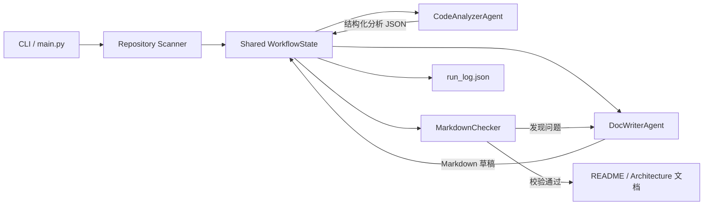

# Design.md — Simple Workflow MVP（文档生成流程）

## 1. 项目概述

本项目实现一个可运行的简单多 Agent Workflow：输入任意代码仓库，自动分析代码结构，并生成 README 与架构说明文档。

整体流程：

```text
代码仓库 → 仓库扫描 → 代码分析 Agent → 文档编写 Agent → Markdown 校验器 → 输出文档
```

项目目标是把“代码理解”和“技术文档生成”拆分成两个职责清晰的 Agent，通过共享状态和结构化消息完成协作，并用确定性校验器检查文档质量。

## 2. 总体架构



核心设计原则：

1. Agent 不直接互相调用，而是通过 `WorkflowState` 共享输入和结果；
2. Agent 之间传递结构化数据，而不是只传自然语言；
3. 文档生成后进行确定性校验，不依赖另一个 LLM 判断质量；
4. 每一步记录事件和耗时，便于追踪与演示。

## 3. Agent 设计

### 3.1 CodeAnalyzerAgent

职责：读取扫描后的代码文件，提取可验证的项目事实。

输入：

- `repo_path`；
- `file_inventory`：文件路径、语言、行数、截断后的内容；
- `analysis_mode`：`full` 或 `summary`。

输出 JSON 中包含：

- `project_name`：项目名称；
- `language`：主要语言；
- `entry_points`：入口文件；
- `dependencies`：内部或外部依赖；
- `modules`：模块路径、用途、公开 API、依赖关系和证据；
- `architecture`：组件及组件关系；
- `uncertainties`：无法从代码确认的事项。

约束：只描述代码中存在的事实；无法确认的信息必须写入 `uncertainties`。

### 3.2 DocWriterAgent

职责：根据结构化分析结果生成 Markdown 文档。

输入：

- `analysis`：代码分析 Agent 输出的 JSON；
- `document_type`：`readme` 或 `architecture`；
- `issues`：上一轮校验发现的问题（修订时提供）。

输出：

- 完整的 Markdown 文档；
- README 或架构说明所需章节。

约束：不得编造文件路径、安装命令、配置项或接口。

## 4. Workflow 控制

### 4.1 顺序执行

基本流程严格按照以下顺序执行：

```text
扫描仓库 → 代码分析 → 文档生成 → 文档校验 → 输出
```

### 4.2 条件分支

根据扫描到的文件数量选择分析粒度：

- 文件数 ≤ `BRANCH_THRESHOLD`（默认 30）：`full` 全量分析；
- 文件数 > 30：`summary` 摘要分析，降低上下文压力。

该分支会写入执行日志。

### 4.3 循环修订

文档生成后由 `MarkdownChecker` 做规则检查。如果发现问题：

```text
校验失败 → 将问题列表交回 DocWriterAgent → 重新生成 → 再次校验
```

最多修订 `--max-retries` 次。该循环体现 Workflow 中的基本流程控制。

### 4.4 错误处理与恢复

- LLM 网络错误或 HTTP `429/5xx`：自动重试 3 次；
- 分析 Agent 返回非法 JSON：自动重试 1 次；
- 文档校验失败：触发文档修订循环；
- 无可用 LLM Key：默认进入 Mock 模式，保证流程可离线演示。

## 5. 共享状态

`WorkflowState` 是 Workflow 的单一状态容器，主要字段包括：

| 字段 | 说明 |
|---|---|
| `run_id` | 本次运行标识 |
| `repo_path` | 输入仓库路径 |
| `document_type` | 文档类型 |
| `file_inventory` | 扫描得到的文件列表 |
| `analysis` | 代码分析 Agent 的结构化结果 |
| `document_plan` | 流程分支、分析模式等计划信息 |
| `draft` | 文档 Agent 当前生成的 Markdown |
| `issues` | 校验器剩余问题 |
| `revision_count` | 修订轮数 |
| `events` | 带耗时的执行事件日志 |

每次运行还会输出：

- `<type>.analysis.json`：结构化分析结果；
- `<type>.run_log.json`：完整状态与事件日志。

## 6. 可扩展性

新增文档类型或新 Agent 时，不需要重写主流程：

1. 在 `DocWriterAgent` 中增加文档类型对应的章节约束；
2. 在 `MarkdownChecker.REQUIRED_SECTIONS` 中增加校验规则；
3. 在 CLI 的 `--type` 中注册新类型；
4. 如需新增 Agent，在 Orchestrator 中增加节点，并继续使用 `WorkflowState` 传递数据。

例如可以扩展为：

```text
CodeAnalyzerAgent → APIDocAgent → DocWriterAgent → Checker
```

## 7. 目录结构

```text
Homework2_WorkflowMVP/
├── main.py                 # CLI 入口
├── workflow/
│   ├── state.py            # 共享状态
│   ├── scanner.py          # 仓库扫描
│   ├── llm.py              # LLM 客户端与 Mock
│   ├── agents.py           # 两个 Agent
│   ├── checker.py          # 确定性校验器
│   └── orchestrator.py     # 流程编排
├── sample_project/         # 内置演示仓库
├── output/                 # 默认输出目录
├── .env.example            # 配置模板
├── run_deepseek.ps1        # DeepSeek 一键运行
├── run_mock.ps1            # 离线演示
└── README.md
```

## 8. 运行方式

离线演示：

```powershell
python main.py --repo sample_project --type all --mock
```

真实模型：

```powershell
$env:OPENAI_API_KEY="你的key"
$env:OPENAI_BASE_URL="https://api.deepseek.com"
$env:OPENAI_MODEL="deepseek-chat"
python main.py --type all
```

如果 `.env` 中设置了 `DEMO_REPO`，不传 `--repo` 时会使用该仓库；否则默认使用内置的 `sample_project`。这样既方便本机演示，也保证提交后在其他机器上可以直接运行。

## 9. 评分项对应

| 评分维度 | 对应实现 |
|---|---|
| 流程完整性 40% | 扫描、分析、生成、校验、输出端到端可运行 |
| Agent 协作 30% | 分析 Agent 输出 JSON，编写 Agent 消费 JSON，通过 WorkflowState 共享状态 |
| 可扩展性 20% | 文档类型、校验规则、Agent 节点均可扩展 |
| 文档 10% | README、Design.md、Mermaid 架构图和运行说明 |

## 10. 已知限制

- Mock 模式只用于展示 Workflow，其模块描述是占位内容；
- 大型仓库需要先通过 `--max-files` 和 `--max-file-bytes` 控制上下文；
- 当前未实现并行 Agent 和可视化编排界面；
- 文档生成质量仍依赖所使用的 LLM 能力。
